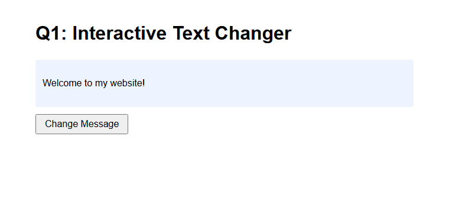
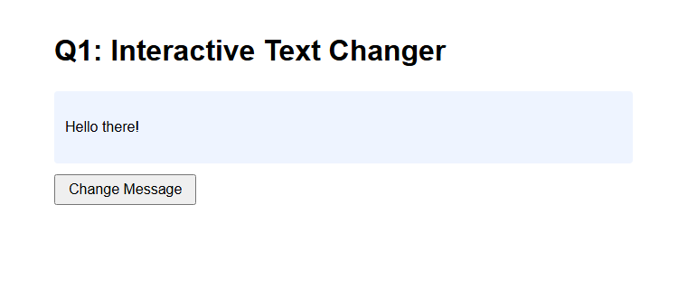
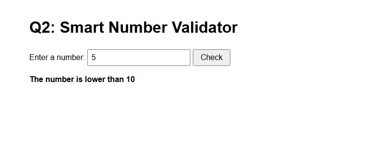
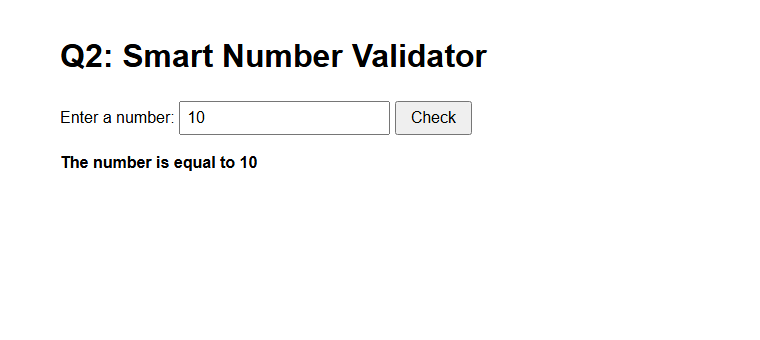
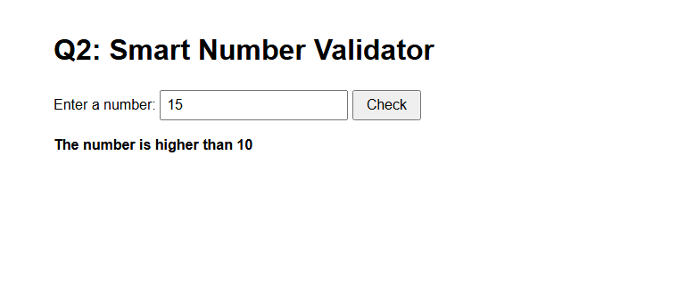
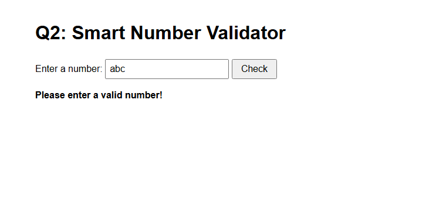
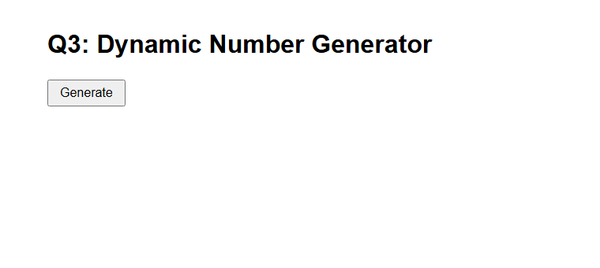
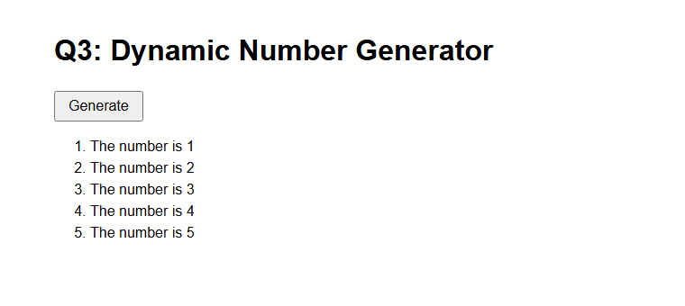

# Lab 4a: Client-Side Scripting (JavaScript)

BIC21203 Web Development, Academic Session 2026/2027

**Name:** Uthman 'Affan bin Mohd Sawi @ Rahim
**Matric No.:** CI240092

## About

Three small interactive pages written in plain HTML5 and JavaScript (no libraries). Each question has its own folder with an `index.html` and an external `script.js` loaded with `defer`. Events are registered with `addEventListener()`, and all text on the page is set with `textContent`.

| Folder | Question | What it does |
|--------|----------|--------------|
| [`q1/`](q1/) | Interactive Text Changer | `changeMessage()` replaces "Welcome to my website!" with "Hello there!" when the button is clicked |
| [`q2/`](q2/) | Smart Number Validator | `checkInput()` trims the input, converts it with `Number()`, rejects empty or non-numeric values, then uses `if...else if...else` to compare with 10 |
| [`q3/`](q3/) | Dynamic Number Generator | `generateNumbers()` clears the list, then a `for` loop (1 to 5) builds each `<li>` with `createElement()` |

## How to run

No server or install is needed.

1. Clone the repository.
2. Open `q1/index.html`, `q2/index.html` or `q3/index.html` in a modern browser (double-click, or use VS Code Live Server).

## Screenshots

### Q1: Interactive Text Changer

| Before click | After click |
|---|---|
|  |  |

### Q2: Smart Number Validator

| Input | Result |
|---|---|
| `5` |  |
| `10` |  |
| `15` |  |
| `10.5` |  |
| `abc` |  |
| empty |  |
| spaces only |  |

### Q3: Dynamic Number Generator

| Before click | After three clicks (no duplicates) |
|---|---|
|  |  |
